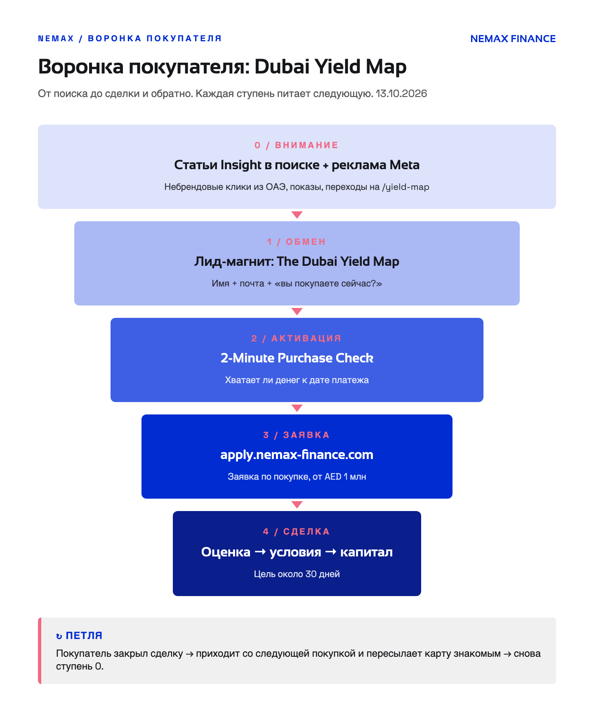
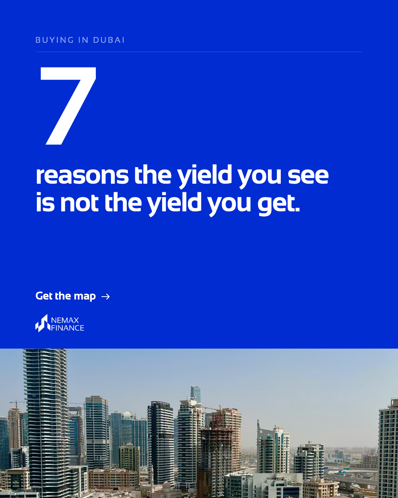
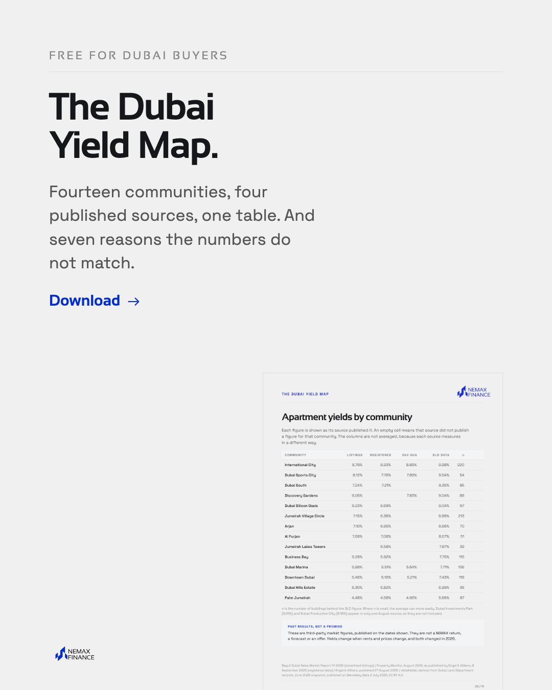
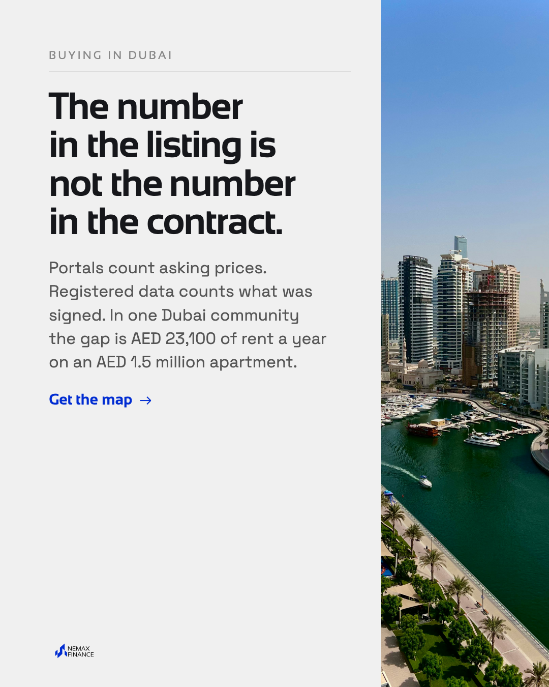
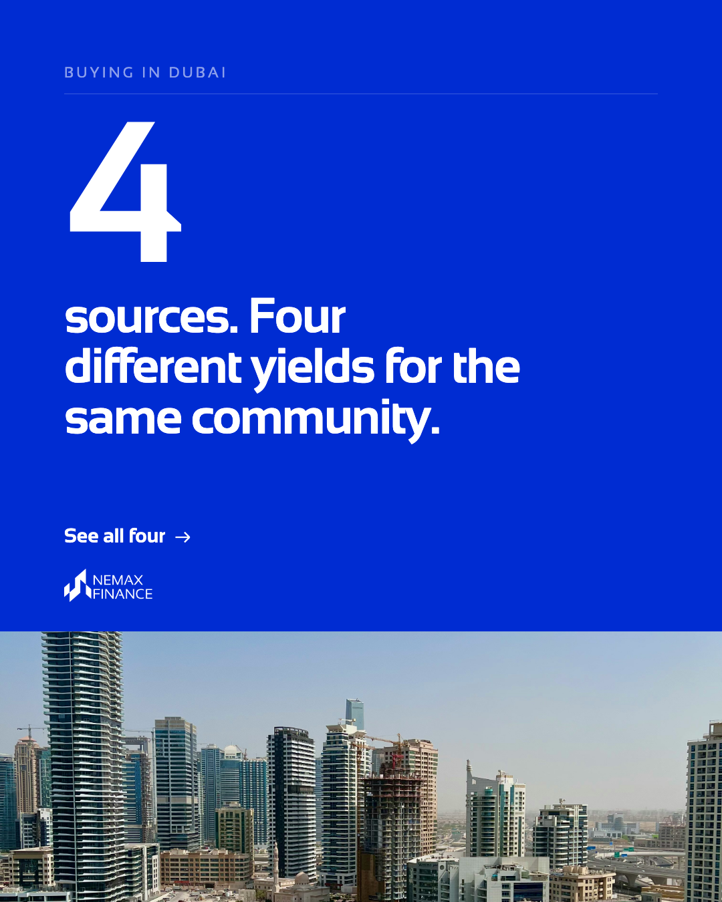
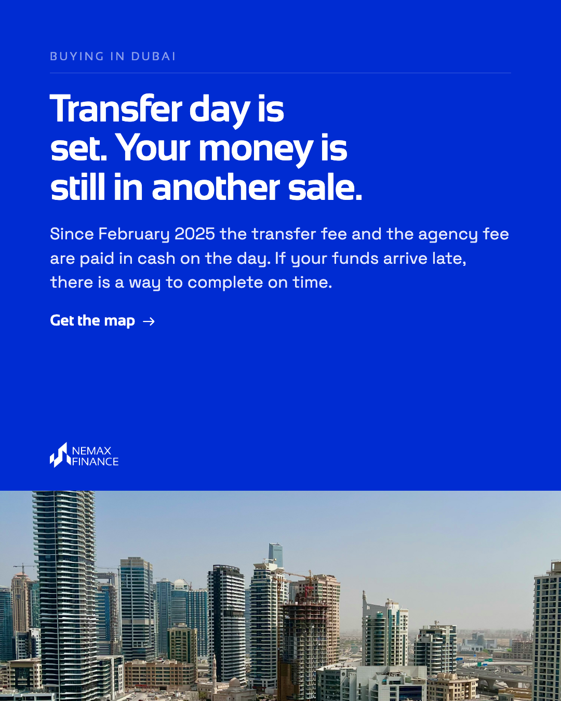
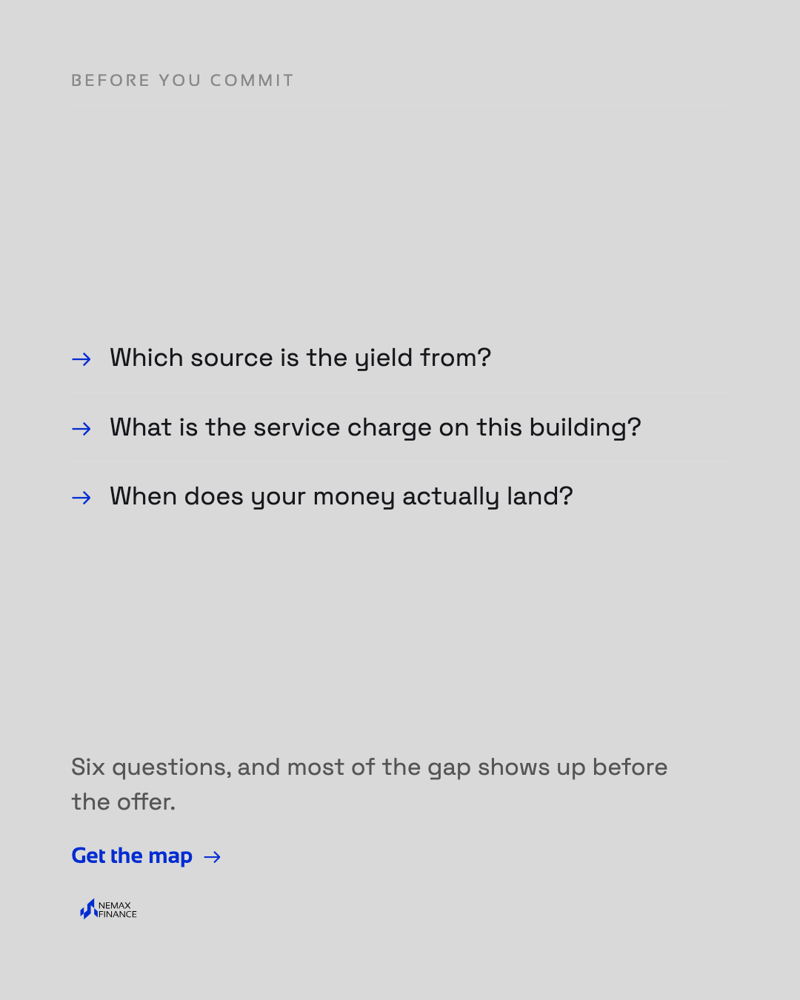

# NEMAX: воронка покупателя — Dubai Yield Map, реклама, письма, контент

Обновлено 15.10.2026. Зеркало брокерской воронки ([nemax-broker-ads](https://github.com/iramum/nemax-broker-ads)),
но для конечного покупателя: человека, который покупает квартиру в Дубае как вложение.
Любой файл скачивается так: открыть его → кнопка **Download raw file** (стрелка вниз справа сверху).
Скачать всё разом: зелёная кнопка **Code** → **Download ZIP**.

## 🔎 Маше на проверку

1. **Текст карты в Word** — [для покупателя](map/NEMAX-Dubai-Yield-Map-v3-BUYER-for-review-2026-10-15.docx) и [для брокера](map/NEMAX-Dubai-Yield-Map-v3-BROKER-for-review-2026-10-15.docx).
   Жёлтым — цифры и даты для сверки. Зелёным — абзацы из плейбука «7 Reasons» дословно. Красным — вопросы до выпуска.
2. **Как сверстано** — [PDF для покупателя](map/NEMAX-Dubai-Yield-Map-v3-BUYER-DRAFT-2026-10-15.pdf) и [для брокера](map/NEMAX-Dubai-Yield-Map-v3-BROKER-DRAFT-2026-10-15.pdf), по 12 страниц.
3. **По каким правилам написан текст** — [STYLE_MASHA.md](STYLE_MASHA.md): разбор языка плейбука «7 Reasons» и что из него взято.
4. **Откуда вопросы на стр. 11** — [research/REDDIT_QUESTIONS.md](research/REDDIT_QUESTIONS.md).

## Что изменилось 15.10

- Добавлена стр. 11 **«What buyers ask»**: шесть вопросов, которые покупатели задавали на Reddit в августе–октябре 2026, и короткие ответы. Ещё два вопроса вплетены в причины 01 и 03.
- Язык проверен по стандарту B2 проекта (средняя фраза ≤ 16 слов, ни одной длиннее 30, grade ≤ 9):

  | Редакция | Средняя фраза | Фраз длиннее 25 слов | Grade | Итог |
  |---|---|---|---|---|
  | Покупатель | 12,1 слова | 1% | 6,3 | SHIP |
  | Брокер | 12,2 слова | 2% | 6,3 | SHIP |

  Проверка на шаблонные обороты (anti-AI): 0 в обеих.
- Цифры перепроверены 15.10: с 13.10 новых выпусков нет ни у одного источника ([research/yield-map-refresh-2026-10-15.md](research/yield-map-refresh-2026-10-15.md)).

## 🧭 Воронка

**[FUNNEL_BUYER.md](FUNNEL_BUYER.md)**: кого привлекаем, зачем скачивать карту, что человек делает дальше,
когда звонить, что уже готово и чего нет.

## 🗺 Лид-магнит: The Dubai Yield Map

Две редакции на одних и тех же страницах: для покупателя («you») и для брокера («your buyer»).

| Файл | Что это |
|---|---|
| [YIELD_MAP_v3_BUYER_TEXT.md](map/YIELD_MAP_v3_BUYER_TEXT.md) / [BROKER](map/YIELD_MAP_v3_BROKER_TEXT.md) | Текст по страницам |
| [research/yield-map-refresh-2026-10-13.md](research/yield-map-refresh-2026-10-13.md) | Откуда каждая цифра: старое → новое, источник, дата, уровень |
| [research/yield-map-refresh-2026-10-15.md](research/yield-map-refresh-2026-10-15.md) | Перепроверка 15.10 |

## ✅ Ступень 2: Purchase Check

[NEMAX-2-Minute-Purchase-Check-v1-DRAFT.pdf](purchase-check/NEMAX-2-Minute-Purchase-Check-v1-DRAFT.pdf):
одна страница, восемь вопросов «да / нет», по форме брокерского Deal Check. Кнопка ведёт на портал заявок.

## ✉️ Письма прогрева

[emails/EMAILS_BUYER.md](emails/EMAILS_BUYER.md): email д0 → WhatsApp д2 → email д3, д7, д14 → звонок д21 →
email д30, д45 → раз в квартал. Для тех, кто ответил «Just researching» или молчит.

## 📣 Реклама Meta

[ads/ADS_KIT_BUYER.md](ads/ADS_KIT_BUYER.md): тексты объявлений, лид-форма дословно, аудитории, сборка кампании.
Каждый кадр в трёх форматах: `4x5` лента, `1x1` квадрат, `9x16` сторис. На кадрах нет процентов.

**Стартовая пара** ([ads/creatives/1_start](ads/creatives/1_start)):

| `B01_seven` | `B05_map_table` |
|---|---|
|  |  |

**Для теста** ([ads/creatives/2_test](ads/creatives/2_test)):

| `B02_listing_contract` | `B03_four_sources` | `B04_transfer_day` | `B06_three_questions` |
|---|---|---|---|
|  |  |  |  |

⚠️ Кадр `B05` показывает таблицу в версии 14.10 (11 страниц); цифры в ней те же.

## 📱 Контент для Instagram

[instagram/IG_CONTENT_BASE_BUYER.md](instagram/IG_CONTENT_BASE_BUYER.md): опоры, банк тем, план на первые четыре недели, идеи рилсов.

## 🌐 Страницы сайта

[site/](site/): блоки для `/yield-map` и `/thank-you/yield-map` (Webflow Embed). Форма на странице
нативная, её поля расписаны в комментарии блока `22c`. Обе страницы пока не опубликованы.

## Что ещё не сделано

- обложка карты: нужна картинка;
- страницы `/yield-map` и `/thank-you/yield-map` и PDF в Webflow Assets;
- кампания Meta в кабинете, конверсия `Yield map lead` в пикселе;
- отправка писем: Brevo на бесплатном тарифе не даёт автоматизаций;
- формулировку «use the property they are buying as security» подтвердить у Макса;
- правило индекса аренды (ответ 4 на стр. 11) проверить по первоисточнику.
