# NEMAX: воронка покупателя — Dubai Yield Map, реклама, письма, контент

## 🧭 Как это работает

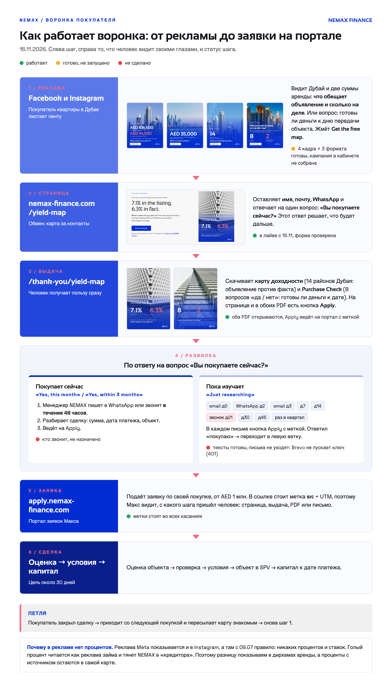

1. **Реклама** в Facebook и Instagram: Дубай и две суммы аренды, «в объявлении» и «на деле». Кнопка «Get the free map».
2. **[/yield-map](https://nemax-finance.com/yield-map)**: имя, почта, WhatsApp и один вопрос «Вы покупаете сейчас?».
3. **[/thank-you/yield-map](https://nemax-finance.com/thank-you/yield-map)**: карта доходности (14 районов) + Purchase Check (8 вопросов) + кнопка Apply.
4. **Развилка по ответу.** «Покупаю в этом месяце / в ближайшие 3» → менеджер NEMAX пишет или звонит в течение 48 часов.
   «Пока изучаю» → цепочка писем (д0, WhatsApp д2, д3, д7, д14, звонок д21, д30, д45), в каждом письме Apply.
5. **Заявка** на портале apply.nemax-finance.com: в ссылке метка, Макс видит, с какого шага пришёл человек.
6. **Сделка:** оценка → проверка → условия → SPV → капитал, цель около 30 дней.

> **Почему в рекламе и в Instagram нет процентов.** Правило с 09.07.2026: никаких процентов и ставок в Instagram.
> Реклама Meta показывается и там. Голый процент читается как реклама займа и тянет NEMAX в «кредитора».
> Поэтому разницу показываем в дирхамах аренды (AED 106,500 против AED 94,500 на одной квартире),
> а проценты с источником и датой остаются внутри самой карты.

Подробно по шагам: **[FUNNEL_BUYER.md](FUNNEL_BUYER.md)**.

Любой файл скачивается так: открыть его → кнопка **Download raw file** (стрелка вниз справа сверху).
Скачать всё разом: зелёная кнопка **Code** → **Download ZIP**.

## 🔎 Маше на звонок 16.11

1. **Реклама, набор v3** — [ads/creatives/0_v3_2026-11-16](ads/creatives/0_v3_2026-11-16), тексты в [ads/ADS_KIT_BUYER.md](ads/ADS_KIT_BUYER.md) §0:

   | `Z1_listing_vs_fact` | `Z2_aed_gap` | `Z3_fourteen_communities` | `Z4_transfer_day_check` |
   |---|---|---|---|
   | 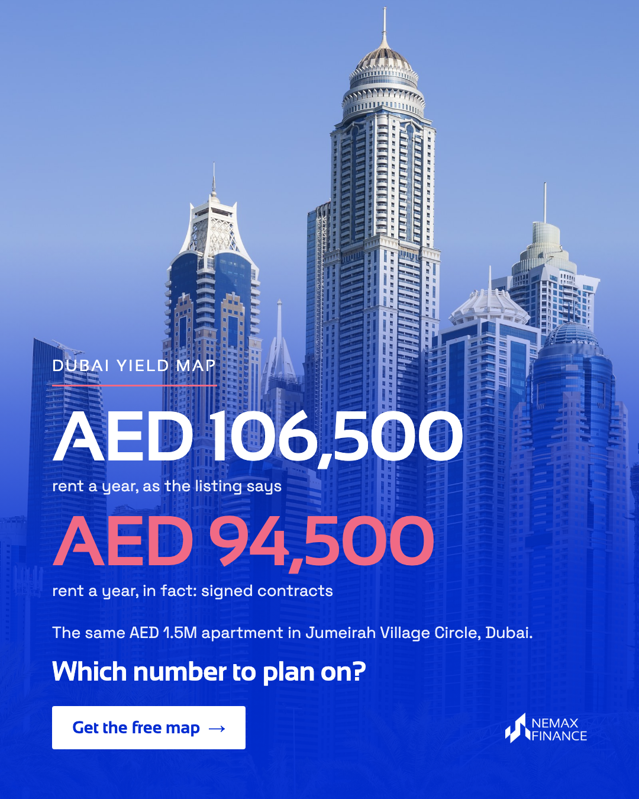 | 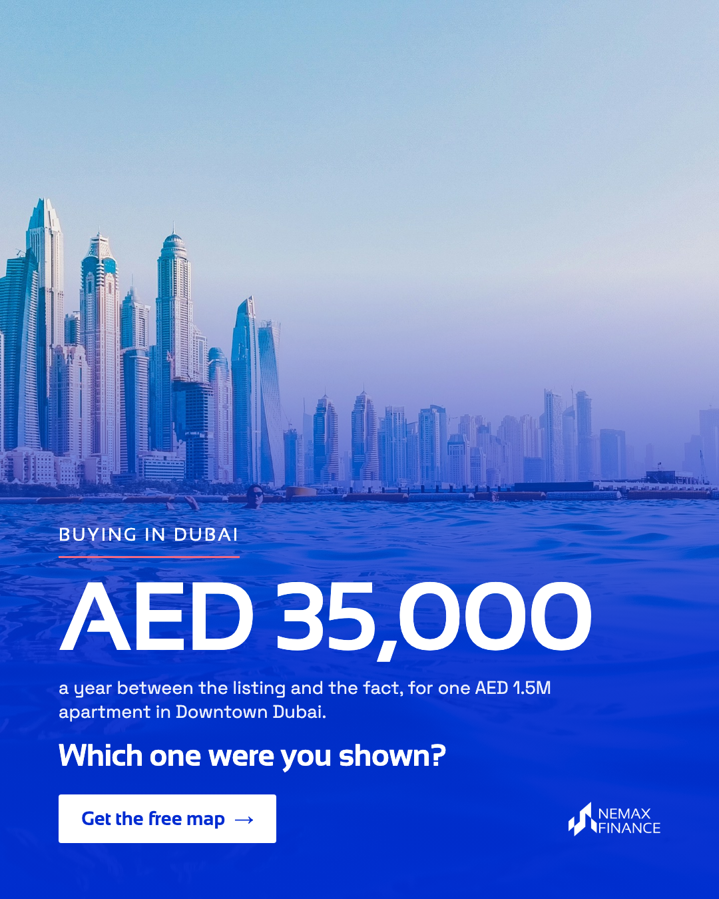 | 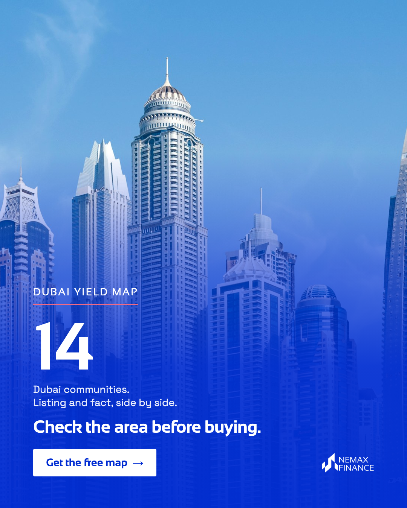 | 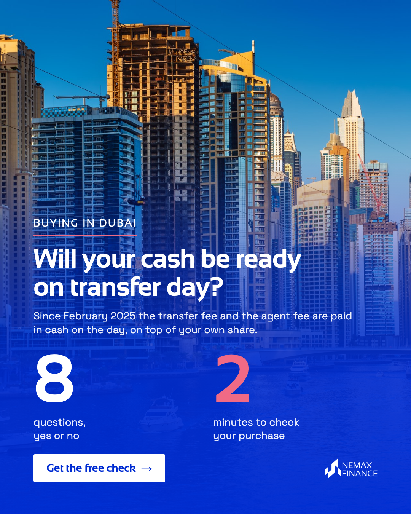 |

   Без названий компаний, без процентов, фото Dubai Marina. Местоимения не висят в конце строки. Все четыре идут на все плейсменты, Instagram тоже.
2. **Карта** — [PDF для покупателя (стоит на сайте)](map/NEMAX-Dubai-Yield-Map.pdf) и [для брокеров](map/NEMAX-Dubai-Yield-Map-for-brokers.pdf), по 12 страниц, с новой обложкой.
   Текст, как он стоит в вёрстке: [покупатель](map/YIELD_MAP_BUYER_TEXT_from_Figma_2026-11-16.md), [брокер](map/YIELD_MAP_BROKER_TEXT_from_Figma_2026-11-16.md).
3. **Обложки** — [карта C3](map/covers/yield-map-cover-C3-2026-11-16.jpg), [брокерская C3](map/covers/yield-map-cover-broker-C3-2026-11-16.jpg), [Purchase Check](map/covers/purchase-check-cover-2026-11-16.png).
4. **Purchase Check** — [PDF, 2 страницы](purchase-check/NEMAX-2-Minute-Purchase-Check.pdf): обложка + 8 вопросов, кнопка «Apply now →» на портал.
5. **Решить Маше:** в абзацах о NEMAX на стр. 02 и 12 стоит «We» (4 раза), стоп-стандарт его запрещает. Замены готовы: «NEMAX co‑finances…», «NEMAX provides…».

## Что изменилось 16.11 вечером

- **Реклама v3 вместо v2:** «listing и fact» вместо «registered data» и «3 sources»; суммы аренды в AED вместо процентов; Bayut и Property Monitor убраны; фото Dubai Marina; у Purchase Check назван день (transfer day) и почему; местоимения склеены со следующим словом и не висят.
- **Обложка C3** (карта и брокерская): подписи «In the listing» / «In fact», без названий компаний, «Which number do you plan on?». Оригинал C2 в Figma не тронут, C3 лежит рядом. В обеих PDF заменена первая страница, ссылка Apply в конце на месте.
- **Сайт (в Webflow, ждёт её Publish):** первый экран «7.1% in the listing. 6.3% in fact.», «Same area» сверху, без компаний и без «3 published sources»; блок «что внутри» без повтора цифр и без списка компаний (источники сноской в карте); страница выдачи без «three published sources»; местоимения везде склеены со следующим словом, висячих нет; SEO и OG-картинка обновлены; новая PDF на странице выдачи.
- **Схема воронки** первой в этом README.

## Что изменилось 16.11

- **Страницы опубликованы** и проверены по живому коду: форма ведёт на страницу выдачи, оба PDF открываются, Apply ведёт на портал Макса с меткой источника.
- **Новый хук первого экрана:** «7.1% in the listing. 6.3% in the registered data.» + подписи, чья цифра, + «Which number do you plan on?». «12 pages» убрано отовсюду.
- **Новая обложка** с двумя крупными цифрами; такая же для брокерской редакции; своя обложка у Purchase Check (8 / 2).
- **Цифры перепроверены 16.11:** новых выпусков нет ([research/yield-map-refresh-2026-11-16.md](research/yield-map-refresh-2026-11-16.md)).
- **Гейты по тексту из Figma:** B2 SHIP, anti-AI 0, стоп-слова чисто. Во всём тексте карты и в Purchase Check короткие слова не висят в конце строки.
- **Apply с UTM везде:** первый экран, страница выдачи, обе PDF, в конце каждого письма ([emails/EMAILS_BUYER.md](emails/EMAILS_BUYER.md)).
- **Почты сотрудников со страниц убраны.**

## Что изменилось 12.11

- **Цифры на ноябрь 2026** ([research/yield-map-refresh-2026-11-12.md](research/yield-map-refresh-2026-11-12.md)):
  Listings = Bayut Q3 2026 (сентябрь), Registered = Property Monitor ноябрь 2026 (страница Engel & Völkers от 12.11),
  DLD data = июньский датасет. Колонка «E&V Aug» снята: в таблице три источника, а не четыре.
  ⚠️ Ноябрьский Property Monitor выше листингов во всех районах, раньше было наоборот. Выгрузку стоит перепроверить.
- Новые примеры: причина 01 = Jumeirah Village Circle 7.10% / 6.3% (сентябрь), причина 02 = Downtown Dubai 5.10% / 7.43%,
  причина 06 = смешанный Q3 и 136,100 домов в 2027 (пресса).
- Текст приведён к правилам ноября: объект держит ADGM SPV, NEMAX co-finances **вместо** банка и не доплачивает
  к ипотеке (взнос по ипотеке только из своих средств), объект с golden visa в SPV не ставится,
  дисклеймер «NEMAX structures asset-backed co-financing secured by real estate and does not operate as a retail bank» на стр. 12.
- Те же правки в письмах (2, 3, 4, 6), Purchase Check, рекламе (B02 = AED 12,000, B03 = «3 sources», B05 = новая таблица) и блоках сайта.
- Страницы `/yield-map` и `/thank-you/yield-map` собраны в Webflow черновиками, не опубликованы.
- Instagram: новая сетка 8 постов с 19.11 (ЧТ + СБ) или с 30.11 (ПН + СР).
- B2: покупатель SHIP (6), брокер 8, из них 4 балла дают оглавление и строка источников. Anti-AI: 0 в обеих.

## Что изменилось 15.10

- Добавлена стр. 11 **«What buyers ask»**: шесть вопросов, которые покупатели задавали на Reddit в августе–октябре 2026, и короткие ответы. Ещё два вопроса вплетены в причины 01 и 03.
- Язык проверен по стандарту B2 проекта (средняя фраза ≤ 16 слов, ни одной длиннее 30, grade ≤ 9):

  | Редакция | Средняя фраза | Фраз длиннее 25 слов | Grade | Итог |
  |---|---|---|---|---|
  | Покупатель | 12,1 слова | 1% | 6,3 | SHIP |
  | Брокер | 12,2 слова | 2% | 6,3 | SHIP |

  Проверка на шаблонные обороты (anti-AI): 0 в обеих.
- Ответ 4 на стр. 11 и причина 04 проверены по Указу Дубая № 43 от 2013 года (ст. 1 и 3), источник стоит в подвале стр. 07.
- Цифры перепроверены 15.10: с 13.10 новых выпусков нет ни у одного источника ([research/yield-map-refresh-2026-10-15.md](research/yield-map-refresh-2026-10-15.md)).

## 🧭 Воронка

**[FUNNEL_BUYER.md](FUNNEL_BUYER.md)**: кого привлекаем, зачем скачивать карту, что человек делает дальше,
когда звонить, что уже готово и чего нет.

Схема наверху этого README. Прежняя схема 13.10: [funnel/NEMAX-buyer-funnel-2026-10-13.png](funnel/NEMAX-buyer-funnel-2026-10-13.png).

## 🗺 Лид-магнит: The Dubai Yield Map

Две редакции на одних и тех же страницах: для покупателя («you») и для брокера («your buyer»).

| Файл | Что это |
|---|---|
| [YIELD_MAP_v3_BUYER_TEXT.md](map/YIELD_MAP_v3_BUYER_TEXT.md) / [BROKER](map/YIELD_MAP_v3_BROKER_TEXT.md) | Текст по страницам |
| [research/yield-map-refresh-2026-11-12.md](research/yield-map-refresh-2026-11-12.md) | **Актуально, 12.11:** откуда каждая цифра таблицы, источник, дата, уровень |
| [research/yield-map-refresh-2026-10-13.md](research/yield-map-refresh-2026-10-13.md) | Октябрь: старое → новое |
| [research/yield-map-refresh-2026-10-15.md](research/yield-map-refresh-2026-10-15.md) | Перепроверка 15.10 |

## ✅ Ступень 2: Purchase Check

[NEMAX-2-Minute-Purchase-Check-v1-DRAFT.pdf](purchase-check/NEMAX-2-Minute-Purchase-Check-v1-DRAFT.pdf):
одна страница, восемь вопросов «да / нет», по форме брокерского Deal Check. Кнопка ведёт на портал заявок.

## ✉️ Письма прогрева

[emails/EMAILS_BUYER.md](emails/EMAILS_BUYER.md): email д0 → WhatsApp д2 → email д3, д7, д14 → звонок д21 →
email д30, д45 → раз в квартал. Для тех, кто ответил «Just researching» или молчит.

## 📣 Реклама Meta

[ads/ADS_KIT_BUYER.md](ads/ADS_KIT_BUYER.md): тексты объявлений, лид-форма дословно, аудитории, сборка кампании.
Каждый кадр в трёх форматах: `4x5` лента, `1x1` квадрат, `9x16` сторис.

**Набор v3, 16.11 вечер — основной:** см. «Маше на звонок» наверху.

**Набор v2, 16.11 днём — заменён v3, не ставить** ([ads/creatives/0_v2_2026-11-16](ads/creatives/0_v2_2026-11-16)), в стиле обложки:

| `Y1_two_numbers` ⛔ только Facebook | `Y2_aed_gap` | `Y3_fourteen_three` | `Y4_purchase_check` |
|---|---|---|---|
| 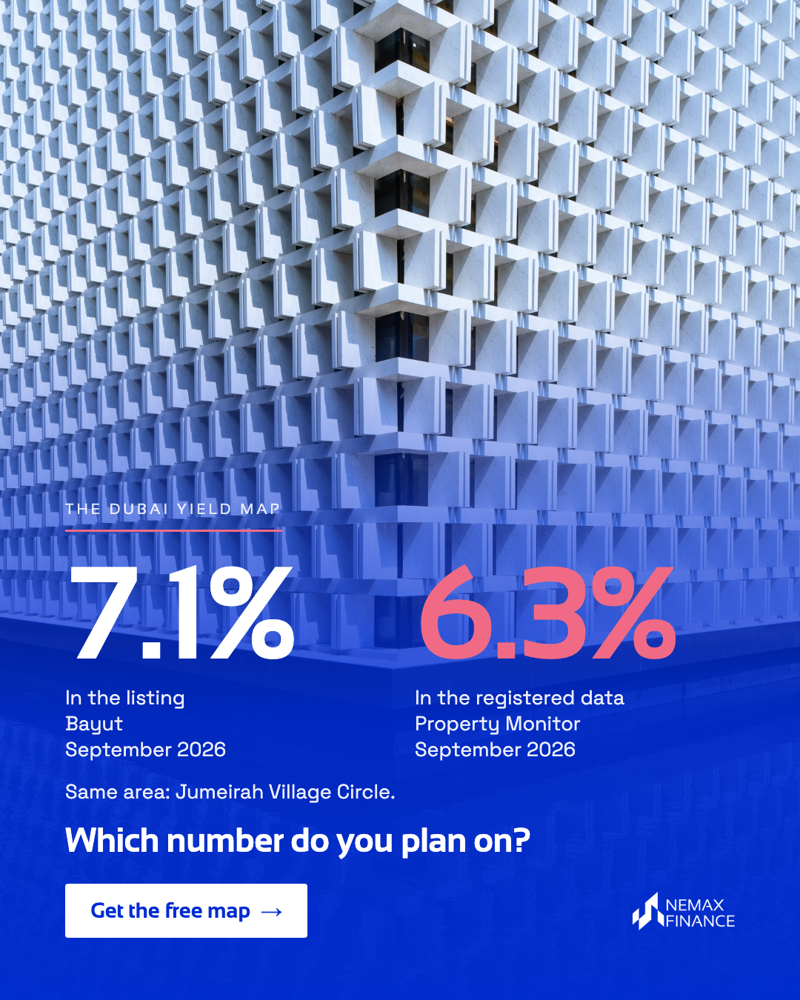 | 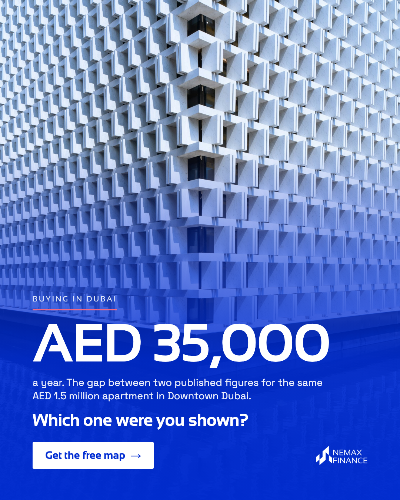 | 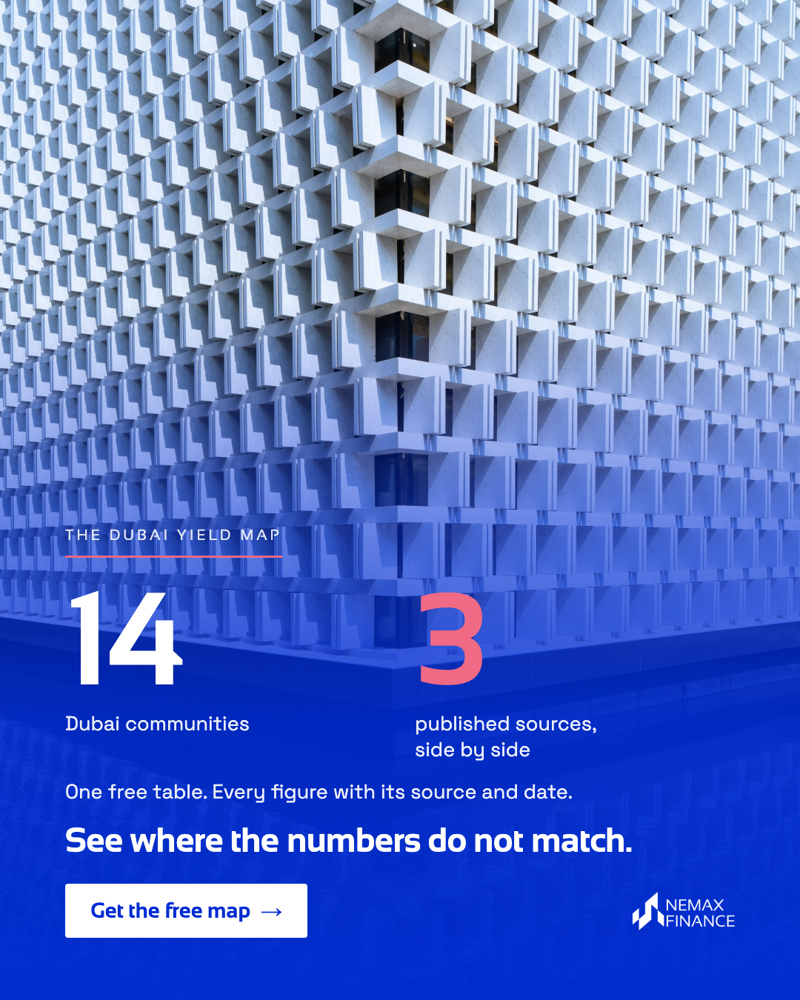 | 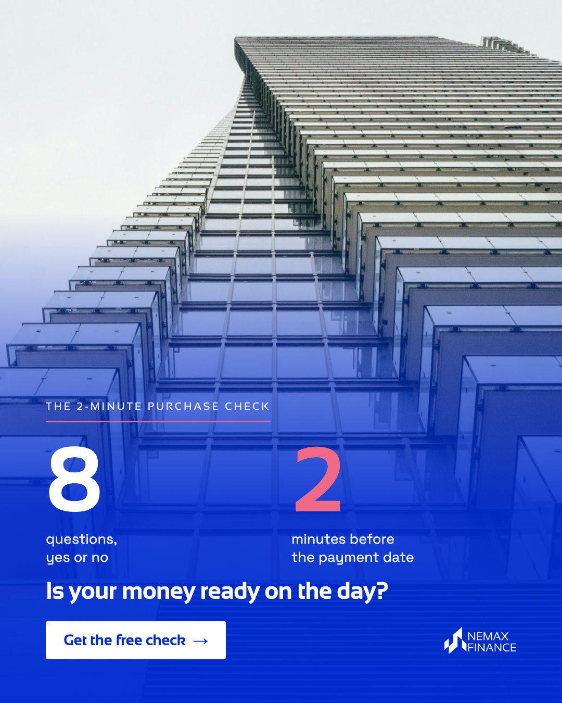 |

Y1 несёт проценты, поэтому идёт только в ленту Facebook (в Instagram процентов не ставим). Y2–Y4 без процентов, на все плейсменты.
Стартовая пара теперь Z1 + Z3 (v3).

**Прежний набор (14.10–12.11), стартовая пара** ([ads/creatives/1_start](ads/creatives/1_start)):

| `B01_seven` | `B05_map_table` |
|---|---|
|  |  |

**Для теста** ([ads/creatives/2_test](ads/creatives/2_test)):

| `B02_listing_contract` | `B03_three_sources` | `B04_transfer_day` | `B06_three_questions` |
|---|---|---|---|
| 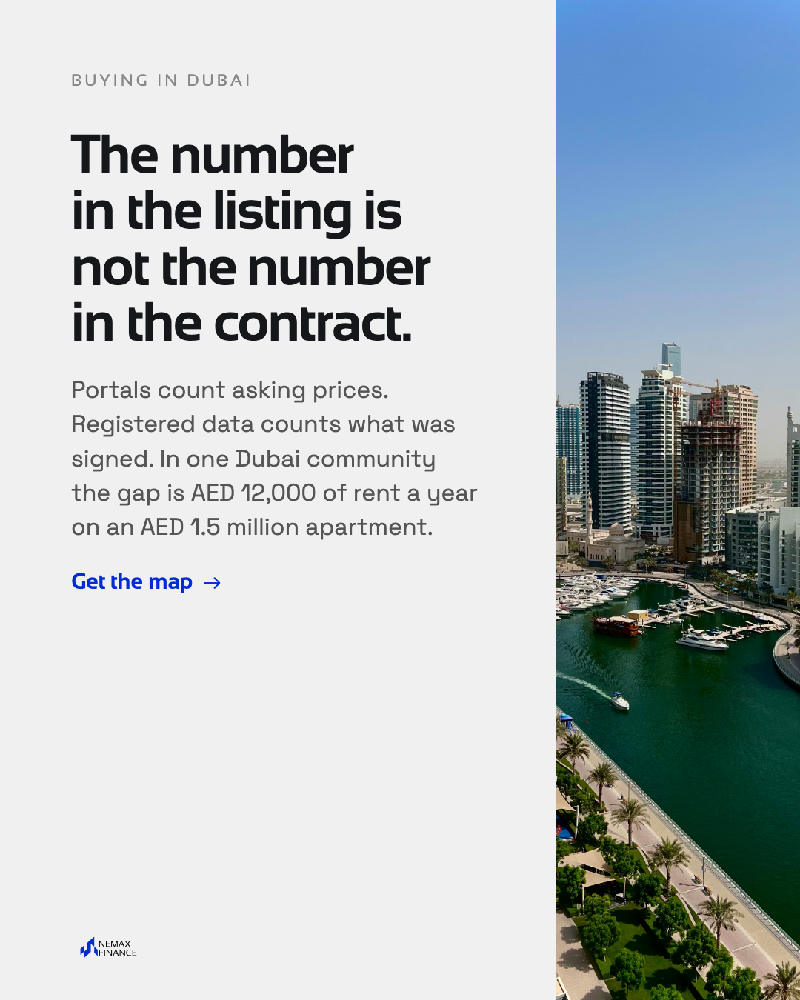 | 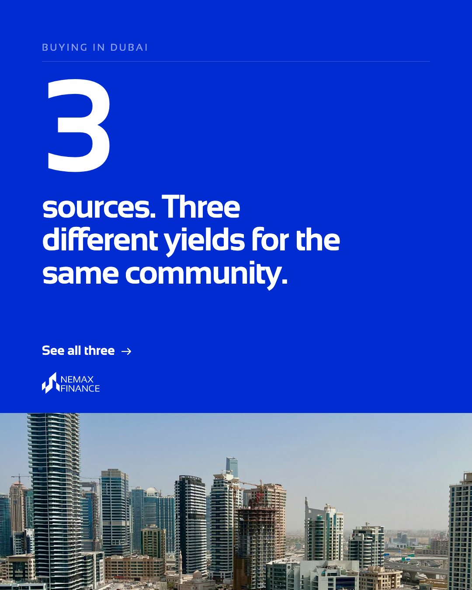 | 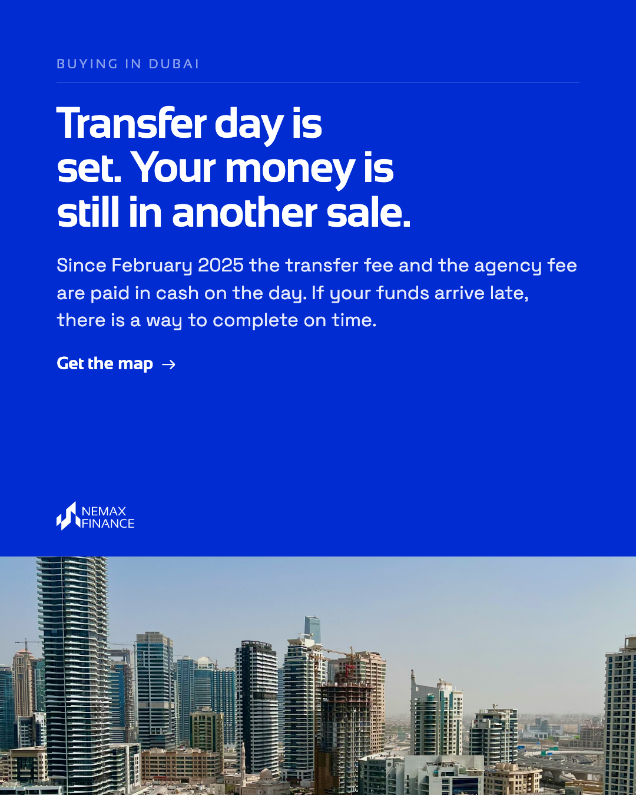 |  |

## 📱 Контент для Instagram

[instagram/IG_CONTENT_BASE_BUYER.md](instagram/IG_CONTENT_BASE_BUYER.md): опоры, банк тем, план на первые четыре недели, идеи рилсов.

## 🌐 Страницы сайта

[site/](site/): блоки для `/yield-map` и `/thank-you/yield-map` (Webflow Embed). Форма на странице
нативная, её поля расписаны в комментарии блока `22c`. 12.11 обе страницы собраны в Webflow черновиками, не опубликованы.

## Что ещё не сделано (16.11)

- кампания Meta в кабинете, конверсия `Yield map lead` в пикселе, страны для нерезидентов;
- письма: Brevo пока не пускает ключ (ограничение по IP), автоматизаций на бесплатном тарифе нет; списки под карту и «Apply for Capital» — после доступа;
- брокерская редакция карты: рассылка брокерам из Brevo;
- вход на /yield-map с главной и из статей про доходность;
- 🔴 ноябрьский Property Monitor выше листингов во всех районах — ждёт проверки;
- можно ли «ипотека банка + капитал NEMAX на взнос» — вопрос Максу, до ответа этот ход нигде не предлагается.
- 🔴 сайт: правки 16.11 вечером внесены в Webflow, ждут Publish.
